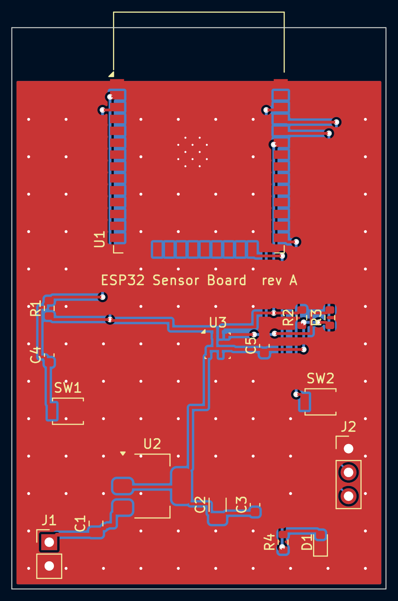
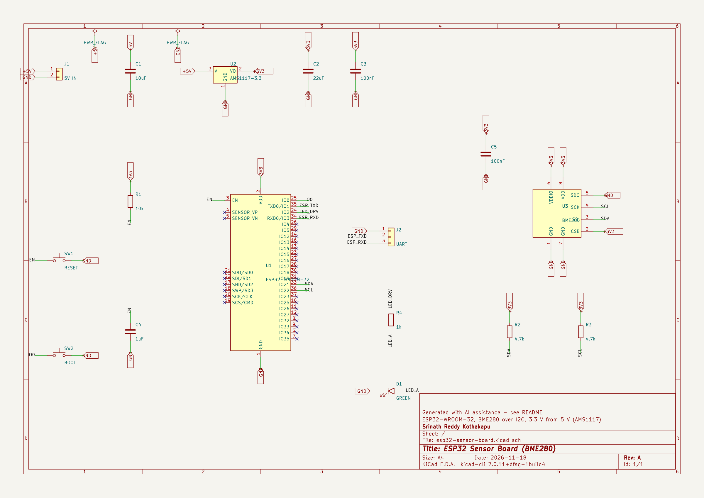

# ESP32 Sensor Board (BME280)

A compact 40 × 60 mm, 2-layer board with an ESP32-WROOM-32 and a Bosch BME280 for temperature, humidity and pressure. It runs from a 5 V input. Designed in KiCad 7.



## Schematic



## Overview

| Block | Parts | Notes |
|---|---|---|
| Power | J1, C1, U2 (AMS1117-3.3), C2, C3 | 5 V in, 3.3 V rail for MCU and sensor |
| MCU | U1 (ESP32-WROOM-32), R1, C4, SW1, SW2 | Reset (EN) and boot (GPIO0) buttons |
| Sensor | U3 (BME280), C5, R2, R3 | I2C, address 0x76 |
| Status LED | R4, D1 | Green LED on GPIO2 |
| Programming | J2 (GND / TX / RX) | 3.3 V USB-UART adapter |

### Pin map

| Signal | ESP32 | Connected to |
|---|---|---|
| SDA | GPIO21 | BME280 SDI, 4.7 k pull-up |
| SCL | GPIO22 | BME280 SCK, 4.7 k pull-up |
| LED | GPIO2 | 1 k → D1 → GND |
| BOOT | GPIO0 | SW2 to GND |
| EN | EN | 10 k pull-up, 1 µF to GND, SW1 to GND |
| UART | GPIO1 / GPIO3 | J2 |

The BME280 has CSB tied to 3.3 V (I2C mode) and SDO to GND, which gives address **0x76**.

## Design notes

- **Regulator:** AMS1117-3.3, cheap and simple for 5 V input. Being linear, it isn't efficient, so a buck converter would be better for battery use.
- **Reset:** the 10 k + 1 µF RC on EN gives a clean power-on reset. The ESP32 needs EN to rise after the supply is stable.
- **Boot mode:** hold SW2 (GPIO0 low) during reset to enter the serial bootloader.
- **Antenna:** the module overhangs the top edge, with a copper keepout under the antenna area.
- **Ground:** pours on both layers, stitched with vias.

## Verification

- Schematic-to-PCB netlist matches: 52/52 connections.
- KiCad DRC at 0.2 mm clearance: 0 errors, 19 warnings ([report](docs/drc_report.txt)). The warnings are the intentional antenna overhang and footprint library paths.
- Still to do: ERC, manufacturer DFM check, and a hardware bring-up.

## Known issues

- C2 (22 µF on the AMS1117 output) should be tantalum or low-ESR. Some AMS1117 parts can oscillate with pure ceramic.
- The BME280 is a 2.5 × 2.5 mm LGA, which isn't hand-solderable. It needs hot air or a breakout module.
- No USB or auto-reset circuit, so flashing needs the BOOT button and an external adapter.
- No reverse-polarity or over-current protection on the 5 V input.
- The ground zones are saved unfilled. Press **B** in the PCB editor to refill them.

## Roadmap

- [ ] Re-route the board by hand in KiCad
- [ ] Fix C2 and run ERC + DFM
- [ ] Add USB-C with a CP2102/CH340 and auto-reset
- [ ] Replace the LDO with a buck converter
- [ ] Order prototypes and write a firmware test (read the BME280, blink the LED)

## Repository layout

```
hardware/   KiCad 7 project, schematic and PCB
docs/       BOM, DRC report, images
```

## Opening the project

Install KiCad 7 or newer and open `hardware/esp32-sensor-board.kicad_pro`.

## Author

Srinath Reddy Kothakapu, M.Sc. Sensor Systems Technology, Hochschule Karlsruhe
